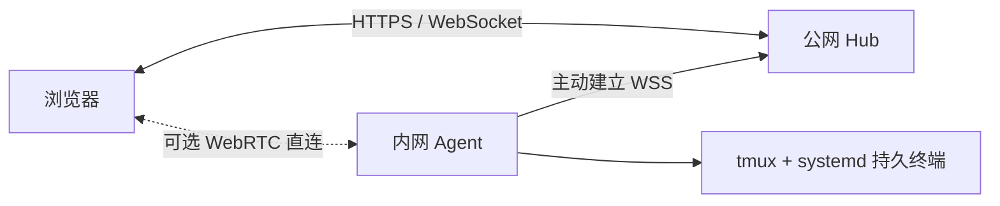

# Workdeck · 自托管远程终端工作台

通过浏览器管理多台 Linux 机器上的持久终端。计算节点只需能访问公网，不需要公网 IP，也不需要开放 SSH 或终端入站端口。

适合在桌面、平板和手机之间继续 Shell、Codex 等 TUI 工作。关闭浏览器或重启 Hub / Agent 服务后，终端进程继续运行。

- **统一管理**：节点接入、重命名、终端创建 / 关闭 / 重命名，目录逐级选择。
- **持久会话**：tmux + systemd 独立托管终端，SQLite 和节点记录保存管理状态。
- **多设备登录**：默认记住登录 30 天，设备之间独立；每个终端一个控制者，其他连接只读，可明确接管。
- **自适应链路**：WebSocket 中转立即可用，后台比较 WebRTC 直连；合适时切换，失败自动回退。
- **网络可视化**：展示实际链路、两条路径的延迟，以及终端数据的上传 / 下载速率。
- **显示适配**：移动端、全屏、可记忆字号；支持中文和复杂彩色 TUI。
- **主机复用**：Hub 所在机器也可以安装 Agent 作为计算节点；以 root 安装 Agent 时，新终端使用 root。

> 操作系统重启会结束本机进程。Workdeck 会保留终端记录并标记丢失，不会自动重放之前执行的命令，也不提供进程检查点恢复。



## 一键部署

准备一台 Linux amd64 / arm64 服务器，安装 **Docker Engine、Docker Compose v2、curl、tar**。将域名解析到服务器，并允许入站 TCP 80 / 443；这两个端口应可供新部署的 Caddy 使用。

将下面的示例域名换成自己的域名后执行：

```sh
curl -fsSL https://raw.githubusercontent.com/Cptzzzzz/workdeck/main/scripts/install-hub.sh \
  | sudo sh -s -- --domain work.example.com
```

安装器下载源码并在 Docker 中构建，无需宿主机安装 Go 或 Node。默认安装到 `/opt/workdeck`，自动启动 Hub 和 Caddy，由 Caddy 申请 HTTPS 证书。首次构建需要下载依赖并交叉编译两个架构的 Agent，耗时取决于服务器性能和网络。

完成后访问 `https://work.example.com`，用户名为 `admin`，初始密码保存在服务器本地：

```sh
sudo cat /opt/workdeck/secrets/admin_password
```

登录后可修改密码。安装器不会覆盖数据库中已经修改的密码。重复执行相同安装命令即可更新源码并构建，数据库、证书、节点与终端记录均保留。

若服务器已有反向代理，使用 `--proxy`，避免启动新的 Caddy；若只是本机试用，使用 `--local`。配置、升级、备份与已有 Caddy 的部署方式见 [部署指南](docs/deployment.md)。

## 接入计算节点

1. 登录工作台，点击“接入新节点”，生成 10 分钟有效的一次性接入命令。
2. 在目标 Linux 机器安装 `curl`、`tmux`，确认 systemd 可用。
3. 以希望终端实际使用的账户执行命令：root 创建系统服务，普通账户创建用户服务。
4. 普通账户执行 `sudo loginctl enable-linger "$(id -un)"`，确保注销后及开机后服务仍可运行。

主服务机器也用同样方式接入。完整步骤与故障处理见 [节点接入指南](docs/agent-setup.md)。

接入完成后，浏览器无需访问节点地址；Agent 主动连接 Hub。可选直连不需要手工配置端口映射，也不会影响中转的可用性。

## 本地开发

需要 Go 1.25+、Node.js 22+、Linux tmux 和 systemd。普通用户须有可用的 systemd 用户管理器。

```sh
git clone https://github.com/Cptzzzzz/workdeck.git
cd workdeck
mkdir -p .secrets
chmod 700 .secrets
# 初始密码至少 6 个字符，包含 ASCII 字母和数字，不要求大小写。
printf 'Wd6' > .secrets/administrator.txt
openssl rand -hex 24 >> .secrets/administrator.txt
chmod 600 .secrets/administrator.txt
scripts/build.sh
bin/workdeck-linux-$(uname -m | sed 's/x86_64/amd64/;s/aarch64/arm64/') hub \
  --addr 127.0.0.1:8090 --public-url http://127.0.0.1:8090 \
  --data-dir .secrets/local-hub --admin-password-file .secrets/administrator.txt
```

浏览器访问同一个 `http://127.0.0.1:8090` 地址。开发节点可使用 CLI 接入本机 HTTP Hub；不要覆盖现有生产节点的数据目录，见 [开发与贡献](CONTRIBUTING.md)。

前端构建会自动执行固定版本的 xterm DOM 渲染补丁，修复字宽取整及多样式片段累积导致的末列截断。请保留 npm 安装脚本；升级 xterm 前需审查补丁并运行相关浏览器回归。

## 项目结构

```text
cmd/workdeck/         Hub / Agent 命令行入口
internal/hub/         登录、SQLite、节点与终端管理、反向连接中转
internal/agent/       节点身份、systemd / tmux 生命周期、目录与直连
internal/protocol/    控制消息与连接封装
web/src/              React 工作台、xterm、网络探测及链路选择
web/tests/            浏览器与前端逻辑回归
scripts/              构建、部署、接入、许可与发布检查
deploy/              独立部署及已有 Caddy 的模板
docs/                中文设计、部署、运维和验证文档
```

## 文档与许可

- [架构与生命周期](docs/architecture.md)
- [双模式工作区技术方案](docs/workspace-design.md)（规划中的文件编辑与预览功能，尚未实现）
- [部署指南](docs/deployment.md) · [节点接入](docs/agent-setup.md)
- [运维手册](docs/operations.md) · [验证指南](docs/verification.md)
- [敏感信息与脱敏规则](docs/security.md) · [安全问题反馈](SECURITY.md)
- [开发与贡献](CONTRIBUTING.md) · [第三方许可](THIRD_PARTY_NOTICES.md)

Workdeck 是单管理员工作台，终端拥有安装 Agent 的系统账户权限。它不提供多租户隔离或命令沙箱。

本项目采用 [MIT 许可证](LICENSE)。依赖及其原始版权声明见第三方许可清单。
