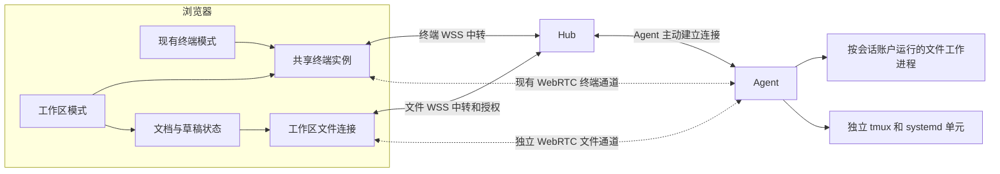
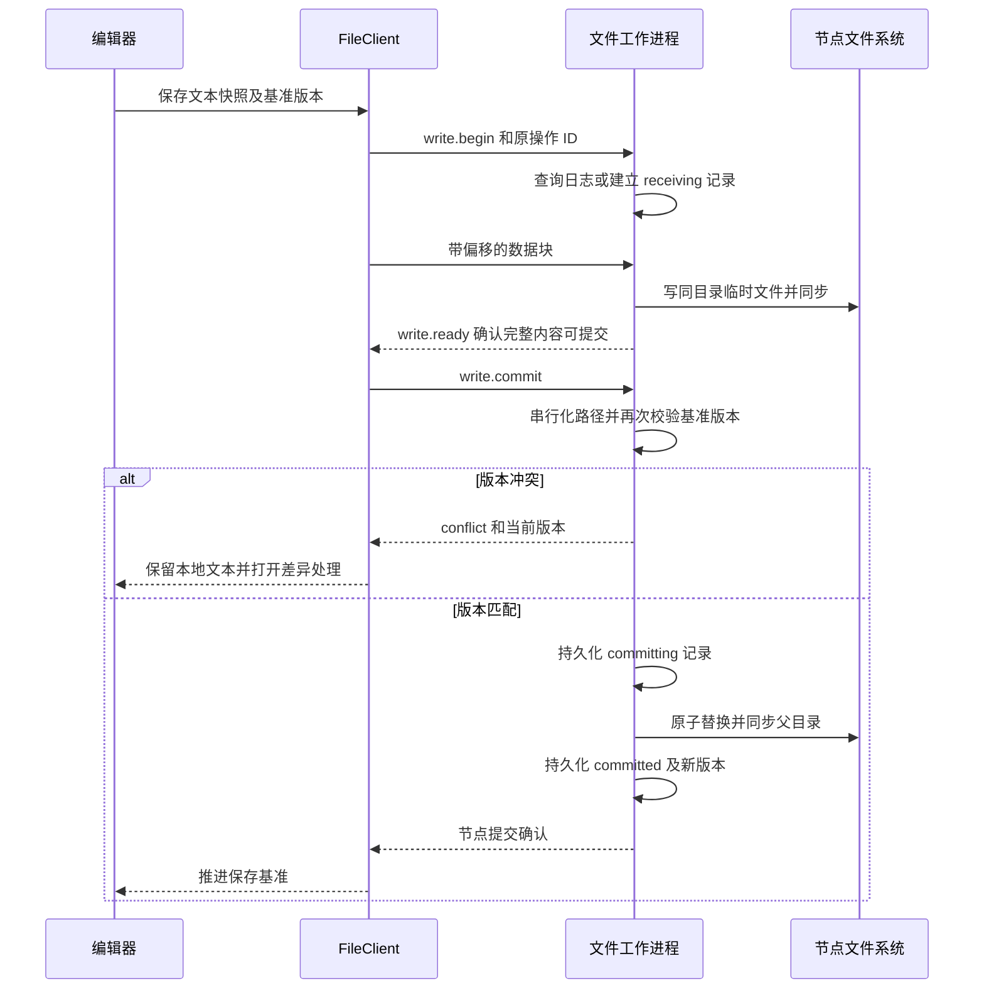

# 双模式工作区技术方案

状态：需求已确认，正在实施；实际完成情况和待验证事项以[开发进度](workspace-progress.md)为准。本文中的组件选型和资源预算是设计目标，不代表已经全部采用或完成验收。

Workdeck 保留现有终端模式的布局和视觉风格，新增可切换的工作区模式。工作区包含远程文件树、可编辑的代码与 Markdown、多格式预览和持久终端。两种模式共享会话和连接，模式切换只调整显示，不创建或终止任务。文件访问同样采用 WebSocket 默认可用、WebRTC 按需直连的传输方式。

本方案面向桌面浏览器，重点验证 macOS Chrome / Safari、Windows Chrome / Edge 和 Linux Chrome / Firefox。当前的单管理员、Linux Agent、tmux 和 systemd 生命周期保持不变。

## 已确认的产品行为

| 项目           | 行为                                                                                 |
| -------------- | ------------------------------------------------------------------------------------ |
| 双模式         | 首次使用默认进入现有终端模式；之后记住当前浏览器上次使用的模式                       |
| 当前终端模式   | 保留现有布局、配色、终端标签和管理操作位置                                           |
| 工作区模式     | 左侧文件树、右上文件编辑与预览、右下终端；左右和上下分栏可拖动                       |
| 模式切换       | 保留当前会话、终端连接、已打开文件、未保存内容和各模式的布局；不弹出无必要的保存确认 |
| 工作区管理入口 | 左下角的会话、节点、账户、设置按钮分别打开管理弹窗，复用现有表单风格                 |
| 文件树根目录   | 默认取创建会话时的工作目录，固定不跟随 Shell 的 `cd`；可通过目录选择器明确更换       |
| 文件刷新       | 顶部提供刷新按钮，默认启用自动刷新；刷新保留展开、选择和滚动状态                     |
| 文件编辑       | 支持语法高亮、查找替换、撤销重做、缩进及保存；默认手动保存，自动保存可在设置中开启   |
| 未保存文件     | 标签显示修改标记；关闭文件时提供保存、放弃、取消；切换文件或会话保留内容             |
| 草稿恢复       | 当前浏览器本地恢复；恢复时重新核对远端版本，不自动覆盖文件                           |
| 外部修改       | 干净文档自动加载新版本；有未保存修改时提示冲突并提供差异处理                         |
| 文件操作       | 新建文件与目录、重命名、删除、上传和下载；删除需站内确认                             |
| 多浏览器       | 已登录管理员均可编辑文件，终端只读状态不限制文件编辑；保存使用版本冲突检查           |
| 终端终止       | 服务主动终止只能由会话管理确认流程触发；关闭视图、模式切换和文件操作不会终止进程     |

系统断电、操作系统重启、用户在 Shell 执行 `exit` 或进程自行结束仍会结束对应进程。此时保留记录和可用画面，显示已退出或已丢失，不自动重放命令。文件工作区是否可用取决于节点和目录，与 Shell 是否仍在运行分开判断。

## 现有代码与新增边界

现有 `internal/agent/directories.go` 仅用于目录选择，返回子目录；`internal/hub/directories.go` 通过控制连接转发请求。它们不承担文件内容传输，也不直接扩展成大型文件响应。

`web/src/terminal-transport.ts` 和 `internal/agent/link.go` 当前将链路、控制权和终端附着绑定。文件权限独立于终端控制权，因此新建工作区连接，复用探测和回退原则，不把文件帧写进终端 PTY 流。

`internal/agent/sessions.go` 继续负责持久进程；文件模块只获得只读的会话身份信息，不获得 `Sessions.Close` 或 systemd 终止能力。前端统一使用 `detachView`、`releaseWorkspace`、`terminateTerminal` 等含义明确的方法名。



## 前端结构和组件

### 双模式容器

全局头部增加终端模式和工作区模式切换按钮，使用当前项目配色和按钮样式。当前模式的侧栏、概览和标签保持原有设计；工作区另有文件树和编辑标签，管理入口位于左下角。两种模式共用一个顶层管理弹窗宿主。

终端实例放在稳定的 `TerminalSessionsHost` 中，按 `terminalId` 保持组件身份。分栏骨架在两种模式中始终存在：编辑面板在终端模式折叠到零，侧栏面板在原侧栏和文件树之间调整可见性，终端宿主不换父节点。外层 CSS Grid 与分栏尺寸共同调整显示，不在两个条件分支里分别创建 xterm，也不把模式加入终端连接 effect 的依赖。终端模式关闭新增分栏拖动，使用原有尺寸规则，避免改变原界面习惯。

从概览切换到工作区而未选择会话时，展示选择或新建会话入口，不隐式创建 Shell。全屏状态下切换模式先退出全屏，避免管理弹窗被全屏层挡住。

### 组件组合

| 职责     | 选型与边界                                                                             |
| -------- | -------------------------------------------------------------------------------------- |
| 应用框架 | 保留 React、TypeScript 和 Vite                                                         |
| 分栏     | `react-resizable-panels`，外层左右分栏，右侧嵌套上下分栏；首版固定区域，不增加自由停靠 |
| 文件树   | Headless Tree 异步数据源，加 TanStack Virtual 仅渲染可见条目；不自动启用文件拖动移动   |
| 编辑器   | Monaco Editor ESM，只按需加载所用语言及 worker；复用模型并提供 Diff Editor 处理冲突    |
| Markdown | `react-markdown`、`remark-gfm`；扩展渲染经过 `rehype-sanitize`，支持编辑、渲染和对照   |
| PDF      | PDF.js，使用自定义范围传输适配器接入文件连接                                           |
| 图片     | 原生图片与 Blob URL，加缩放、适应窗口和拖动；释放不用的 URL                            |
| 管理弹窗 | 提取并复用现有表单组件和 CSS；焦点管理、菜单等按需使用 Radix Primitives                |
| 文件监听 | Agent 文件工作进程使用 fsnotify，辅以可见范围轮询                                      |
| 状态     | 按领域拆分 React 状态与外部 store，不把编辑器文本和高频网络统计放入全应用单一 context  |

选型依据：[分栏组件](https://github.com/bvaughn/react-resizable-panels)提供嵌套方向、约束和布局回调；[Headless Tree](https://headless-tree.lukasbach.com/features/async-dataloader/)提供异步数据接口；[Monaco](https://github.com/microsoft/monaco-editor)提供独立编辑模型、语言和差异编辑能力。引入时选择稳定版本、锁定依赖并更新第三方许可，不使用开发快照。

Monaco 不包含完整 VS Code 工作台和扩展运行环境。首版不引入远程语言服务器、调试或插件市场；通用文本编辑及所支持语言的浏览器能力属于本次范围。

### 尺寸与焦点

分栏初始值为文件树 280 px、右侧预览与终端约 55:45，可拖动并分别记忆。宽高约束保证工具栏和至少可操作的终端区域；支持折叠、最大化和恢复默认布局。

拖动时本地 xterm 在动画帧中重新 fit，远端 resize 合并到至多每秒十次，拖动结束立即补发最终尺寸。隐藏终端不测量，重新显示时立即 fit。Monaco 根据容器变化调用 `layout`。复用现有无内边距的终端测量容器及字宽补丁，继续检查末行、末列和状态栏遮挡。

焦点位于终端时保留其键盘行为。`Cmd/Ctrl+S` 仅在文档区域或当前文件命令上下文执行保存；弹窗关闭恢复先前焦点，拖动结束不擅自把焦点切回终端。

## 数据模型和持久化

### 工作区身份

一个终端默认关联一个独立工作区。工作区包含 `id`、`terminal_id`、`node_id`、`root_path`、`root_revision` 和实际会话账户。根目录与会话创建目录分开保存；更换工作区目录不修改 Shell 的 cwd。

Hub 新增 `workspaces` 表，以 `terminal_id` 建唯一索引，使用增量迁移，不重建原节点、终端和登录表。已有终端首次打开工作区时，从保存的 cwd 创建工作区，由 Agent 确认目录和实际账户。Agent 保存已确认的工作区记录，用工作区修订号拒绝旧根目录请求。

根目录修改采用准备与确认：Agent 验证新目录并保存待提交修订，Hub 将候选修订持久化为待确认，然后要求 Agent 在文件提交协调器中切换根目录并撤销旧连接。确认 Agent 已保存新修订后，Hub 才把候选标记为可用并回复浏览器。中断时通过原操作 ID 查询；若 Agent 已切换，Hub 补齐自己的记录，尚未切换则保留待确认或明确中止。待确认期间不签发新修订的数据票据，所有文件连接都绑定确切的根目录修订。

Agent 记录根目录身份并持有目录句柄。目录移动、替换或重启后身份不匹配时，提示重新绑定；不自动把相同路径下新出现的另一个目录当作原工作区。更换根目录前处理旧根目录的未保存文件，旧修订草稿仍可导出。

### 状态存放位置

| 状态                 | 位置与生命周期                                             |
| -------------------- | ---------------------------------------------------------- |
| 节点和终端           | 现有 Hub SQLite、Agent 会话记录与独立 systemd 单元         |
| 工作区根目录         | Hub SQLite 和 Agent 已确认记录；包含修订和身份信息         |
| 两种模式与分栏尺寸   | 当前浏览器偏好，按账户和布局版本隔离                       |
| 每会话打开文件与视图 | IndexedDB，包含工作区修订、相对路径、光标、滚动和 PDF 页码 |
| 未保存草稿           | IndexedDB，保存基准版本、基准内容、当前内容及编辑序号      |
| 文件内容             | 以节点文件为准；浏览器按需缓存，Hub 不长期存储内容         |
| 文件变更操作结果     | 节点侧持久日志，跨链路和服务重启查询                       |

文档标识包含节点、工作区、根目录修订和相对路径；仅用 `main.go` 等文件名不足以区分不同节点或根目录。同一物理文件在多个会话中打开时，仍由节点版本检查协调保存。

浏览器草稿定时写入并在切换模式、切换会话及页面隐藏时尽力补写。崩溃恢复后先比对远端版本，再决定恢复为修改或进入冲突界面。浏览器清理存储或配额不足时不能承诺保留草稿，须明确显示持久化失败并提供导出；不静默淘汰未保存内容。

## 文件连接和权限

### 建立连接

新增以下 Hub 接口，具体 JSON 类型定义在独立的文件协议模块：

| 接口                                          | 作用                                                                  |
| --------------------------------------------- | --------------------------------------------------------------------- |
| `GET /api/terminals/{id}/workspace`           | 获取工作区及节点文件能力，未初始化时只返回未初始化状态                |
| `POST /api/terminals/{id}/workspace`          | 首次打开时按会话记录幂等创建工作区，校验 CSRF                         |
| `PUT /api/terminals/{id}/workspace`           | 带预期修订更换工作区根目录，执行准备与确认                            |
| `POST /api/workspaces/{id}/connections`       | 校验登录、CSRF 和工作区，签发一次性浏览器连接票据                     |
| `GET /api/workspaces/{id}/ws`                 | 使用票据升级 WSS，校验 Origin 并绑定登录身份                          |
| `GET /api/agent/files`                        | Agent 带节点签名和 Hub 票据主动建立文件中转连接                       |
| `GET /api/workspaces/{id}/operations/{opId}`  | 认证后查询变更操作结果；Hub 经控制请求转发，支持数据连接重建后的恢复  |
| `POST /api/workspaces/{id}/downloads`         | 仅在浏览器无法流式落盘时，明确申请兼容下载票据；不替代正常文件连接    |
| `GET /api/workspaces/{id}/downloads/{ticket}` | 一次性、需登录的兼容下载，Hub 从 Agent 流式转发，并明确显示服务器中转 |

浏览器票据和 Agent 票据分别生成，15 秒有效、单次使用，不可互用；绑定登录、节点、终端来源、工作区、根目录修订和连接代次。票据只用于握手，不写入普通日志。文件连接不依赖浏览器成为终端控制者，也不依赖终端必须处于 running。

Agent 以自己保存的终端记录确定账户和允许的根目录，不采信浏览器发来的 UID、账户或绝对文件路径。每个文件请求都检查授权租约、根目录修订和操作权限，不能只在建立 WebRTC 时检查一次。

### 按账户执行文件操作

每个实际账户使用独立的 `file-worker` 子进程，处理受限的标准输入输出协议，不监听公网端口，不调用 Shell 执行文件命令。普通 Agent 使用自身账户；root Agent 对旧账户使用独立子进程凭据和补充组，不在多线程 Agent 内全局切换 UID。

root 安装与升级流程将相同版本的文件工作程序放在 root 管理、其他账户可执行的 `/usr/local/libexec/workdeck-file-worker`。不能让原普通账户从 `/root` 目录读取 Agent 可执行文件或配置。普通账户安装则使用自己可访问的 Agent 可执行文件。缺少匹配工作程序时只禁用该会话的文件能力，不中断原终端。

操作日志和历史副本放在工作账户自己的私有状态目录，按节点身份隔离，权限为目录 0700、文件 0600。工作程序只通过继承的私有管道接受 Agent 请求，不从用户提供的参数构造任意命令。

### 撤权

文件 WSS 是 WebRTC 的授权租约，保持在线；Agent 控制连接中断也使该代文件连接失效。退出登录、密码撤权、节点撤销、根目录修订变化会关闭对应文件连接和监听。

撤权立即阻止新请求和尚未提交的写入。已经进入不可中断的文件提交可能完成，结果写入日志，后续重新认证后查询；不为断开连接强行回滚已发生的文件修改。所有这些清理只涉及文件资源，不调用终端关闭逻辑。

## 文件协议和传输切换

### 通道划分

每个活跃工作区建立独立文件 WSS，可协商独立的文件 PeerConnection；不共用终端的 PeerConnection 或 PTY 输出窗口。文件 PeerConnection 使用可靠、有序的控制与数据 DataChannel，分别承载请求结果和二进制分块。工作区连接按需建立，隐藏工作区在没有保存任务时释放昂贵连接，草稿继续保留。

目录列表、文件读取、编辑保存、上传下载和变更通知均通过 `FileClient`，不留下绕过它的大文件 HTTP 默认路径。这样图片和 PDF 也可以真正通过 WebRTC 直连，而不仅仅是终端直连。浏览器无法流式写入本地磁盘时的超大文件兼容下载是显式例外，仍由 FileClient 申请受限票据，并显示该次下载实际中转。

### 消息格式

请求使用带版本的 JSON 信封，至少包含 `version`、`type`、`request_id`、`workspace_id`、`root_revision`、`route_epoch` 和 `payload`。相对路径必须经过 Agent 再次验证。

```json
{
  "version": 1,
  "type": "file.write.begin",
  "request_id": "<随机请求标识>",
  "workspace_id": "<工作区标识>",
  "root_revision": 1,
  "route_epoch": 1,
  "payload": {
    "op_id": "<节点时间基准生成的操作标识>",
    "spec": {
      "path": "src/example.go",
      "base_version": "<打开文件时的版本>",
      "size": 2048,
      "sha256": "<本次保存内容摘要>"
    }
  }
}
```

操作命名统一使用 `workspace.*`、`directory.*`、`file.*`、`watch.*`、`operation.*`，不复用终端控制消息的 `create`、`close` 等命令。

| 请求组   | 操作                                                                       |
| -------- | -------------------------------------------------------------------------- |
| 目录     | `directory.list`，带快照游标、筛选和隐藏项设置                             |
| 文件属性 | `file.stat`，返回类型、大小、权限、修改时间和版本                          |
| 读取     | `file.read.open`、`file.read.chunk`、`file.read.close`，绑定预期版本和读取标识 |
| 写入     | `file.write.begin`、`file.write.commit`、`file.write.abort`                |
| 管理     | `file.create`、`directory.create`、`file.rename`、`file.remove`            |
| 恢复     | `operation.status`、上传已确认偏移查询                                     |
| 刷新     | `watch.subscribe`、`watch.unsubscribe`、`watch.invalidated`、`watch.reset` |

文件请求 ID 使用 48 位十六进制，前八字节为节点时间基准下的毫秒时间戳，后十六字节为密码学随机数。连接就绪帧提供节点时间基准。节点先查询已有记录，只有未知变更 ID 才检查新建时间窗口；过期或过于超前的未知 ID 不允许重新执行。这使日志清理后仍能拒绝过期操作，不必无限保留全部去重记录。时间字段只用于去重期限，不充当认证凭证，现有终端协议的随机 ID 不改变。

JSON 控制帧最多 32 KiB，目录结果按实际编码字节数分页，不仅按条数限制。二进制帧采用 48 字节头部和至多 32 KiB 数据：4 字节魔数 `WDF1`、1 字节版本、1 字节类型、2 字节保留标志、24 字节请求 ID、8 字节偏移、4 字节数据长度、4 字节链路代次；整数采用网络字节序。保留标志目前必须为零。长度与方向必须匹配活动请求，不能任意分配内存；文件整体摘要在上传或保存提交时核对。

当前中转协议用 `file.ready` 返回节点时间；结果放在信封的 `payload.result`，错误放在 `payload.error`。读取先以 `file.read.open` 打开并记录其请求 ID，再通过 `file.read.chunk` 指定 `read_id`、偏移和长度；数据帧使用该分块请求 ID，随后发送带实际字节数的结果。读取结束发送 `file.read.close`。上传先用 `file.write.begin` 声明操作及摘要，二进制块使用操作 ID，节点以 `file.write.progress` 确认偏移；收到完整确认后才能提交。浏览器票据通过 WebSocket 子协议传递，不放在 URL 中。

同一 DataChannel 内有序不代表两个 DataChannel 之间有序。节点收齐连续数据、核对摘要并同步临时文件后发出 `file.write.ready`，客户端等待该确认再发送 commit。读取完成消息也不能替代数据接收确认，浏览器收齐请求范围后才完成读取。重复块不重复写入，偏移不匹配或同偏移内容不一致时拒绝；取消后的迟到块只丢弃，不重新激活请求。

### 切换与恢复

文件通道先中转，直连按现有策略探测，复用迟滞、冷却、故障回退和禁止 TURN 中继候选冒充直连的原则。探测和冷却按业务隔离，终端链路健康不能替代文件连接自己的校验。状态栏允许同时显示终端直连、文件中转等真实情况。

计划切换时暂停签发新操作，在旧链路确认已处理边界，增加 `route_epoch` 后在目标链路恢复。迟到的旧代分块被丢弃。读取按请求与偏移重发，上传按节点已确认偏移恢复；文件变更操作只查询原操作 ID 的结果，不在另一链路生成新操作盲目重试。

链路失败后中转恢复原请求，文件传输确认和终端确认窗口分开。大文件操作支持取消、进度和并发限制，后台下载不会占用终端输入队列。直连仍然共用节点的物理带宽，因此工作账户总文件速率有限制；终端 RTT 持续恶化时降低文件发送窗口，恢复稳定后逐步放开。

文件路径依据交互延迟、失败、缓冲积压和实际传输进展选择，不声称低 RTT 必然等于大文件吞吐量最优。不额外发送大规模带宽压测流量。面板分别统计两种业务的实际路径、字节与速率，避免把信令或探测当作节省的文件流量。

状态栏明确标记当前终端连接和编辑器文件连接的作用域；兼容下载在任务列表单独显示中转及其流量，不能因为编辑器正走直连就把所有文件任务标成直连。

## 读取和预览

目录读取直接子项，分目录与文件排序，缓存有界快照后分页。游标绑定目录快照和工作区修订；目录变化或快照过期后重新列出并按条目身份恢复选择。目录过大时返回明确的数量限制及筛选入口，不把截断结果标成完整目录。

文本首批支持 UTF-8、UTF-8 BOM、LF 和 CRLF，保存保留已识别的编码与换行。其他编码和混合换行给出明确提示，不自动转码后保存。文件超出可编辑上限时提供受限预览、分段读取和下载，不创建巨大 Monaco 模型。非法 UTF-8 文件名在列表中转义展示并明确标注受限，不悄悄替换成另一个可操作的路径。

Markdown 的相对图片和链接经工作区路径解析后调用同一个 FileClient，保留目录边界校验。原始 HTML 默认禁用，扩展输出使用清洗规则；外部资源不自动加载，防止预览自行发出未经用户选择的网络请求。HTML 或 SVG 文件可查看源码或按受限方式展示，不作为工作台同源脚本执行。[react-markdown 安全说明](https://github.com/remarkjs/react-markdown#security)

PDF 通过 `PDFDataRangeTransport` 把范围请求映射到 FileClient，而不是直接给查看器一个 Hub 文件 URL。按需渲染当前及附近页面，保存页码、缩放和滚动；必要的字体与 worker 从本站加载。PDF.js 的预取和文档结构会影响实际读取范围，不保证只传当前页所需字节。[PDF.js 接口](https://mozilla.github.io/pdf.js/api/draft/module-pdfjsLib.html)

图片通过 FileClient 读取为 Blob URL，限制文件及解码尺寸，在切换或缓存淘汰时释放。Monaco、PDF.js 及 worker 均延迟加载并自托管。CSP 按所需增加本站 worker 和受控 Blob 资源，不使用全局放宽策略。

下载不能把任意大小的文件全部拼成 Blob。支持文件选择和可写流的桌面浏览器可由用户选择目标后，把 FileClient 的数据块直接写盘；相关 API 尚非所有浏览器通用，需能力检测。无该能力时，小文件使用有上限的 Blob，大文件提供明确的兼容中转下载，不宣称该次下载节省了 Hub 流量。[浏览器文件选择接口](https://developer.mozilla.org/en-US/docs/Web/API/Window/showSaveFilePicker)

## 编辑保存和并发冲突

### 文档状态

每个文档维护基准内容、基准版本、当前文本、编辑序号、进行中的保存快照和状态。状态包括 `clean`、`dirty`、`saving`、`conflict`、`uncertain`、`deleted`。

保存捕获当时的文本及编辑序号。保存期间继续输入时，确认只推进基准版本，不把新输入标成已保存，也不把旧快照覆盖回编辑器。后续保存等待前一次结果明确后使用新的基准版本。

自动保存默认关闭；开启后在停止输入一段时间后使用同一保存流程，冲突、离线或结果待确认时暂停自动保存。强制覆盖也必须展示差异，并使用刚确认的远端版本发起新的条件写入，不能跳过版本检查。

### 节点写入流程



可编辑文本版本包含内容 SHA256 和必要文件身份信息。Agent 为所有文件工作进程提供同一个最终提交协调器，串行化工作台发起的保存、重命名和删除，覆盖跨账户访问同一文件的情况；内容传输并发进行，读取不占提交锁。该协调器不借用终端生命周期锁，上传中的临时内容不成为用户可见的目标文件。新建使用独占创建及不覆盖语义；重命名默认禁止覆盖已有目标。

普通文件通过同目录随机临时文件、完整性校验、同步、原子替换和父目录同步提交。保留能够正确维护的所有者和普通权限。无法保留的 ACL、扩展属性、特殊模式或硬链接语义必须明确拒绝原地保存并提供另存，不能静默破坏。符号链接本身不被保存操作替换；可跳转到工作区内实际目标后编辑。

外部程序不一定遵守 Workdeck 的路径锁。提交前版本检查能发现常见的 Codex、编辑器和 Shell 修改，但检查与文件替换之间仍存在外部写入竞态，不能承诺对任意外部进程提供强事务隔离。保留有限的节点侧旧版本副本并提示冲突，作为误覆盖恢复手段；备份仅在对应工作账户私有目录保存，预算和保留数量可配置。

### 确认丢失和服务重启

节点持久操作日志记录操作 ID、账户、工作区修订、参数摘要、基准版本、目标内容摘要、临时文件身份和结果。同 ID 不同参数直接拒绝。状态包括 `receiving`、`ready`、`committing`、`committed`、`conflict`、`aborted`、`uncertain`。

收到 committed 才显示已保存。连接丢失时使用原 ID 查询；节点在替换后、记结果前崩溃，则恢复时核对目标身份和摘要。能够确认目标内容与结果一致时返回已确认结果，否则保留 uncertain，提供比较或另存，不自动再次覆盖。

读取在同一打开文件描述符上完成，分块前后检查身份和变化。恢复连接需要重新确认版本；大文件被原地修改则终止该版本读取并提示更新，不将两版 PDF 或下载内容拼接在一起。

## 文件管理操作

新建、重命名、上传、删除均有唯一操作 ID 和目标前置条件，不能因超时直接重放。编辑和上传共享临时文件及提交实现，不能出现两套不同的落盘语义。

删除文件或目录需要站内确认，明确工作区、路径和范围。禁止删除工作区根目录。非空目录额外明确递归范围；递归删除可能部分完成，遇到权限、外部变化或错误时记录并报告已完成和未完成项，不伪装成原子操作，不自动重试删除后来新出现的内容。删除处理不调用终端终止接口。

已打开文件在工作台重命名后更新相应标签和模型路径；外部重命名无法可靠匹配时标记原路径已删除，并由用户选择新文件。被删除的未保存文档保留文本和另存入口，不自动重建原文件。用户关闭终端后，工作区和草稿记录继续保留，节点在线且目录存在时仍可访问。

## 手动刷新和自动刷新

刷新按钮只重新读取已加载目录和当前文件属性，保留展开、选择、标签、草稿及滚动位置，不清空整棵树。按钮显示刷新中、最近同步状态和错误，节点离线时保留列表并标记过期。

工作进程对展开目录安装监听，收起后按引用计数释放；对当前文件同时监听父目录，兼容原子替换保存。fsnotify 的监听不是默认递归的，网络文件系统也可能不可靠，因此不能把一次通知当作最终文件状态。[fsnotify 说明](https://github.com/fsnotify/fsnotify)

通知使用目录或文件失效事件，由浏览器重新读取权威结果。合并约 250 ms 内的重复变化；批量变化发送一次目录失效，不逐个发送完整内容。刷新结果携带修订和请求代次，较旧响应不能覆盖新状态。

订阅使用监听代次和序号。先安装监听再建立列表快照，在快照期间缓存变化；重连、事件跳号、缓冲溢出或工作进程重启时发送 `watch.reset`，重新核对可见范围。页面重新获得焦点也触发一次核对。可见时约每十秒核对目录元数据和活动文件，作为漏事件或不支持监听的降级。

干净文档收到新版本后更新模型并恢复视图；脏文档只标记冲突。上传、保存或重命名在另一设备发生时遵循同样规则，不将自动刷新当作自动覆盖授权。

## 初始资源预算

以下为实现初值，可在实际验收后调整，不代表已经测得的性能上限。Hub、Agent、工作进程和前端都需独立执行上限校验。

| 资源                 | 初值                                                                      |
| -------------------- | ------------------------------------------------------------------------- |
| 文本编辑大小         | 每文件 5 MiB；超出转受限预览或下载                                        |
| 文件上传大小         | 每文件 1 GiB，可由节点管理员配置                                          |
| 浏览器 Blob 下载     | 每文件至多 64 MiB；更大文件使用流式落盘或明确的兼容下载                   |
| 二进制数据块         | 32 KiB，加 48 字节头                                                      |
| JSON 单帧            | 32 KiB；目录分页同时受编码字节数限制                                      |
| 传输确认窗口         | 每个文件连接 256 KiB，持续积压时暂停读取或发送                            |
| 大文件并发           | 每工作区最多两个传输；小型控制操作单独调度                                |
| 文件速率             | 每工作账户合计初始 8 MiB/s，可配置并按终端延迟降低                        |
| 目录页               | 默认至多 256 项，超过帧预算提前结束该页                                   |
| 单目录扫描           | 至多 20,000 项，超过时明确截断并允许筛选                                  |
| 目录快照缓存         | 每工作账户合计 64 MiB，快照默认三十秒过期，游标失效后重新获取             |
| 监听范围             | 每工作区至多 256 个目录和 32 个活动文件，超出部分按需核对                 |
| 直连数量             | 每浏览器保留至多两个活跃文件 PeerConnection；优先当前工作区及进行中的保存 |
| 本地编辑模型         | 初始最多 20 个；只回收可恢复的干净模型，不丢弃脏文档                      |
| 操作结果日志         | 完成结果至少保留七天；未决结果不会当作成功自动清理                        |
| 未知变更 ID 时间窗口 | 不早于节点时间七天，不晚于五分钟；已记录的操作先按日志查询                |
| 未完成上传           | 无活跃连接且未进入提交时，十分钟后失效；提交中不按此规则删除              |
| 旧版本副本           | 每文件至多十版、每工作账户总计 256 MiB，清理最旧副本                      |

操作记录到期后，同 ID 请求返回已过期并要求重新核对，不能当作从未执行过而再次写入。临时文件只清理日志登记且身份匹配的对象，不按通配符删除用户文件。

## 安全和兼容

路径使用工作区内相对路径，禁止绝对路径、NUL 和越界组件。采用已有 Go 版本可用的 `os.Root` 等基于目录句柄的接口限制访问，再校验打开对象类型，不以字符串前缀或先检查再普通 `Open` 作为边界。它并不自动禁止挂载边界或所有特殊对象，需单独处理。[Go Root 接口](https://pkg.go.dev/os#Root)

所有协议长度、偏移、总量、摘要、目标版本和连接代次都在节点核对。拒绝设备、套接字、管道等对象，并对工作进程设置超时和有界队列，避免异常读取阻塞 Agent 控制循环。项目依然继承操作系统账户权限，文件边界不是终端命令的多租户沙箱。

新增能力声明以节点清单中的实际字段为准，包括 `workspace-control-v1`、`workspace-files-v1`、`workspace-watch-v1`、`workspace-file-direct-v1` 和 `workspace-archive-v1`。旧 Agent 继续使用现有终端模式；切换到不支持的文件工作区时显示升级提示，不断开已有终端。浏览器不能仅凭 Hub 版本就假设所有节点具备写入能力。

升级使用可重复执行的增量迁移，先发布兼容的新 Hub 与前端，再升级 Agent。新前端在文件模块异常时允许返回终端模式。构建需要将编辑器、PDF worker 等本站资源加入现有多阶段镜像；部署架构和节点安装账户规则不变。

## 实现模块

以下是新增或拆分的目标结构，文件名不代表已经存在：

```text
web/src/app/                       双模式容器、模式偏好、全局弹窗
web/src/features/terminal/         从 main.tsx 提取现有终端视图与服务
web/src/features/management/       共用会话、节点、账户和设置弹窗
web/src/features/workspace/        工作区外壳、文件树、分栏和文件标签
web/src/features/editor/           Monaco 模型、保存状态与冲突界面
web/src/features/preview/          Markdown、PDF、图片与二进制占位
web/src/services/files/            FileClient、协议、传输与订阅
web/src/stores/                    工作区、文档、偏好和草稿仓储
internal/protocol/files.go         版本化的文件消息及数据块
internal/hub/workspaces.go         工作区、票据、文件中转及撤权
internal/agent/fileworker.go       工作进程启动、身份和连接调度
internal/files/                    目录访问、写入日志、监听和范围读取
```

先从 `main.tsx` 提取当前终端和管理表单，保持其行为与样式，再引入双模式外壳。文件传输的抽象可以共用探测策略与计量工具，但不在第一次改动中同时重写终端底层协议。

## 开发阶段和验收

| 阶段 | 可交付结果                                 | 关键验收                                                                             |
| ---- | ------------------------------------------ | ------------------------------------------------------------------------------------ |
| 一   | 提取现有终端与弹窗，新增双模式和拖拽外壳   | 原界面截图与交互保持；反复切换、拖拽和隐藏后终端 pane PID 不变，不发送终止请求       |
| 二   | 工作区身份、按账户工作进程、文件协议与中转 | 原普通用户会话不以 root 读写；路径、特殊文件、容量限制生效；旧节点仍可用             |
| 三   | 文件树、Monaco 编辑、手动保存和草稿        | 新建、编辑、查找、保存、重命名和关闭确认可用；切换会话和刷新页面保留草稿             |
| 四   | WebRTC 文件传输、流控和结果恢复            | 中转、直连、切换、断线、节点重启均测试；文件字节确实走选中路径，终端保持运行         |
| 五   | 自动刷新、冲突和多浏览器                   | Codex 新增删除、原子替换和批量变化及时可见；两浏览器保存冲突不静默覆盖；漏事件可恢复 |
| 六   | Markdown、PDF、图片和完整上传下载          | 相对资源及 PDF 范围读取也走 FileClient；大文件不撑满 Hub 内存，取消和恢复有效        |
| 七   | 故障注入、资源与上线回归                   | 崩溃窗口结果可解释；拖拽末列末行不截断；现有登录、终端及部署回归通过                 |

最终版本包含上述完整范围；阶段交付不代表可以省略文件直连或编辑能力。隔离测试使用专用 Hub、节点和数据目录，不借用现有任务进行写入测试。

保存专项需覆盖：两个浏览器同时修改、Codex 外部修改、保存期间继续输入、确认丢失、临时文件同步后崩溃、替换后日志提交前崩溃、根目录切换、权限撤销、磁盘满、配额失败和目录被替换。

传输专项需覆盖：强制中转、真实 DataChannel、变差候选保持中转、活动直连失败、旧链路迟到分块、重复块、取消、超额偏移、哈希不匹配及保存结果查询。大文件与终端同时运行，检查队列有界、控制请求可响应，并比较传输期间的终端延迟。

视图专项需覆盖：当前模式原外观、模式偏好恢复、未选择会话切换、反复往返同一会话不重建连接、隐藏编辑器继续保留脏文档、全屏管理弹窗、Mac 键盘组合键及不同桌面浏览器。
